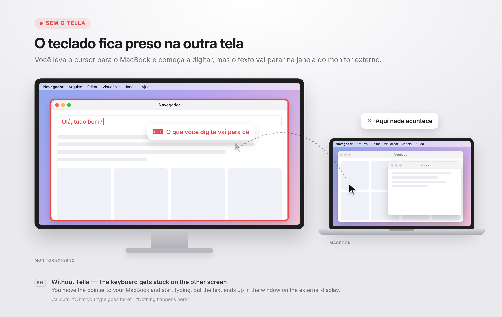
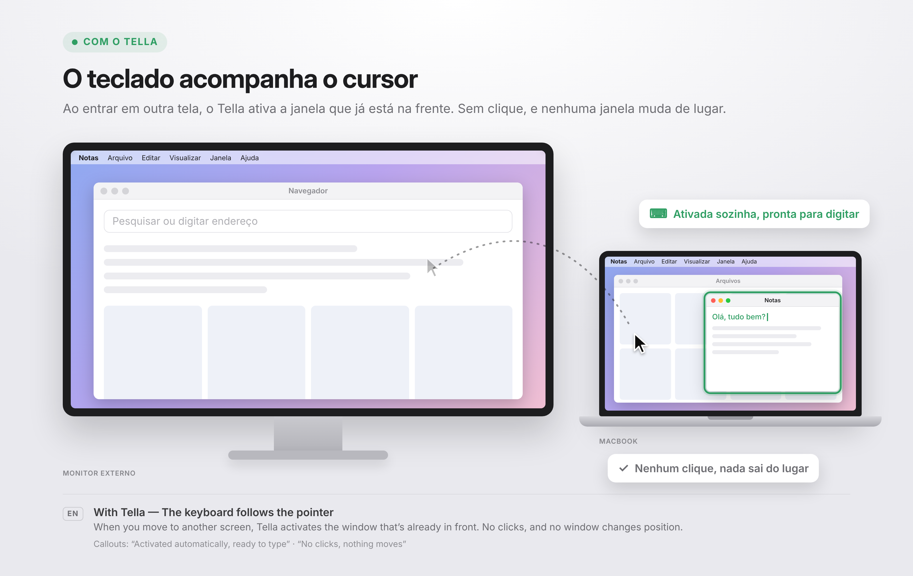

<p align="center">
  
</p>

<h1 align="center">Tella</h1>

<p align="center">
  <b>El teclado sigue a tu cursor entre tu MacBook y tus monitores externos, sin hacer clic.</b>
</p>

<p align="center">
  <a href="README.md">English</a> · <a href="README.pt-BR.md">Português</a> · <b>Español</b>
</p>

<p align="center">
  <a href="https://github.com/arthuislan/tella/releases/latest/download/Tella.dmg"><b>⬇︎ Descargar Tella.dmg</b></a>
  &nbsp;·&nbsp; macOS 13+ · Apple Silicon
</p>

<p align="center">
  
</p>

**Tella** es una pequeña app para Mac, pensada para quienes trabajan con una **MacBook y uno o más monitores externos**. Cuando llevas el cursor a otra pantalla, Tella activa automáticamente la ventana que está al frente en esa pantalla. Así puedes escribir en ella de inmediato, **sin hacer clic**.

Vive discretamente en la barra de menús: no abre ventanas, no mueve nada de lugar y no hace clic en nada.

---

## El problema

En macOS, el teclado siempre escribe en la **app activa**, y una app solo se activa cuando haces clic en ella. Mover el cursor no basta. Con más de una pantalla, esto causa dos molestias del día a día.

### 1. El teclado se queda en la otra pantalla

Estás en el navegador del monitor externo, llevas el cursor a la MacBook y empiezas a escribir una nota. El texto termina en la barra de direcciones del navegador, en la otra pantalla.



### 2. Hacer clic para activar puede estorbar

La solución sería hacer clic en la otra pantalla antes de escribir. El problema es que el cursor muchas veces cae sobre una **ventana de atrás**, más grande, detrás de la ventana pequeña que estás usando. El clic cae en ella, salta al frente y **tapa la ventana que querías usar**.


---

## La solución

Con Tella encendido, cuando el cursor entra en otra pantalla, la app activa la **ventana que ya está al frente en esa pantalla**. No importa dónde cayó el cursor.

- ✅ El teclado sigue al cursor: solo cambia de pantalla y escribe.
- ✅ No se simula ningún clic, así que ningún botón o enlace se activa por accidente.
- ✅ Ninguna ventana cambia de lugar, y la de atrás se queda atrás.



---

## Cómo funciona

1. Cada 30 ms, Tella revisa en qué pantalla está el cursor.
2. Cuando el cursor **cambia de pantalla**, espera un instante (0,12 s) para confirmar que realmente te quedaste ahí.
3. Busca la ventana **más al frente** de esa pantalla y la activa, junto con su app, mediante la API de Accesibilidad de macOS.

Cuidados que toma la app:

- **¿Arrastrando algo entre pantallas?** Si el botón del mouse está presionado, Tella no hace nada, para no interrumpir el arrastre.
- **¿Conectaste o desconectaste un monitor?** Tella solo actualiza su referencia y no activa nada.
- **¿La pantalla no tiene ventanas?** No hace nada.

### Al minimizar una ventana

Si minimizas la ventana que estabas usando, Tella activa **al instante** la ventana que quedó al frente en esa pantalla, normalmente la que estaba detrás. Así sigues escribiendo sin tener que hacer clic.

> **Importante:** Tella actúa **solo cuando el cursor cambia de pantalla o cuando minimizas una ventana**. Todo lo demás funciona como siempre: para cambiar de ventana en la misma pantalla, haces clic normalmente.

---

## Menú de la barra de menús

| Opción | Qué hace |
|---|---|
| **Acerca de Tella** | Muestra la versión, el desarrollador, el sitio web y la licencia. |
| **Actualización disponible: Tella x.y** | Solo aparece cuando hay una versión nueva. Haz clic para descargarla. |
| **Activo** | Enciende o apaga Tella sin cerrar la app. |
| **Abrir al iniciar sesión** | Abre Tella automáticamente al iniciar sesión en tu Mac. |
| **Permiso** | Muestra si la Accesibilidad está permitida (✓) o falta (⚠︎) y agrupa las opciones de abajo. |
| ↳ **Abrir ajustes de Accesibilidad…** | Abre la lista de Accesibilidad en Ajustes del Sistema. |
| ↳ **Volver a pedir permiso** | Muestra de nuevo el aviso de macOS y agrega Tella a la lista. |
| ↳ **Restablecer permiso** | Borra el permiso anterior y lo pide de nuevo. Útil después de actualizar la app. |
| ↳ **Mostrar Tella en el Finder** | Muestra la app en el Finder para que la arrastres a la lista si no aparece. |
| **Buscar actualizaciones…** | Revisa ahora en GitHub si hay una versión nueva. |
| **Buscar actualizaciones automáticamente** | Revisa una vez al día (activado por defecto). Desactívalo si prefieres. |
| **Salir de Tella** | Cierra la app. |

---

## Idiomas

Tella usa automáticamente el idioma de tu Mac. Habla **36 idiomas**:

Português (Brasil) · Português (Portugal) · English · Español · Français · Deutsch · Italiano · Nederlands · Svenska · Dansk · Norsk · Suomi · Polski · Čeština · Slovenčina · Magyar · Română · Hrvatski · Slovenščina · Български · Català · Ελληνικά · Türkçe · Русский · Українська · עברית · العربية · हिन्दी · ไทย · Tiếng Việt · Bahasa Indonesia · Bahasa Melayu · 日本語 · 한국어 · 简体中文 · 繁體中文

Si el idioma de tu Mac no está en la lista, Tella aparece en **inglés**.

Para usar Tella en otro idioma sin cambiar todo tu Mac, ve a **Ajustes del Sistema → General → Idioma y región → Aplicaciones**, haz clic en **+** y elige Tella.

---

## Requisitos

- macOS 13 (Ventura) o posterior
- Mac con Apple Silicon (M1, M2, M3, M4…)
- Permiso de **Accesibilidad**, que Tella necesita para activar ventanas de otras apps

---

## Instalación

### Con el instalador (DMG)

1. Descarga **[Tella.dmg](https://github.com/arthuislan/tella/releases/latest/download/Tella.dmg)** desde la página de [Releases](https://github.com/arthuislan/tella/releases).
2. Abre el DMG y arrastra **Tella** a la carpeta **Aplicaciones**.
3. Abre Tella. Como la app no está notarizada por Apple, la primera vez macOS puede avisar que no puede verificar al desarrollador. Para abrirla de todos modos, ve a **Ajustes del Sistema → Privacidad y seguridad → Abrir de todos modos**, o haz clic derecho en la app y elige **Abrir**.
4. Cuando Tella lo pida, activa el permiso en **Ajustes del Sistema → Privacidad y seguridad → Accesibilidad**.

### Compilar desde el código

Necesitas las herramientas de línea de comandos de Xcode (`xcode-select --install`).

```bash
git clone https://github.com/arthuislan/tella.git
cd tella
./build.sh --install   # compila, instala en /Applications y abre
./build.sh --dmg       # compila y crea el instalador Tella.dmg
```

---

## Solución de problemas

**Tella no activa las ventanas.**
Casi siempre es el permiso de Accesibilidad. Después de una actualización, macOS puede tratar a Tella como otra app.

La forma más fácil de arreglarlo es desde el propio Tella: en el menú, elige **Permiso → Restablecer permiso** y vuelve a activar Tella en la lista de Accesibilidad.

O, desde la Terminal:

```bash
pkill -x Tella
tccutil reset Accessibility local.tella
open /Applications/Tella.app
```

Luego vuelve a activar Tella en **Accesibilidad**.

**Sigue apareciendo el ícono anterior.**
Es la caché de macOS. Para actualizarla:

```bash
touch /Applications/Tella.app && killall Dock Finder
```

**¿Cómo desinstalo?**

```bash
pkill -x Tella
rm -rf /Applications/Tella.app
tccutil reset Accessibility local.tella
```

---

## Actualizaciones

Tella revisa una vez al día la página de [Releases](https://github.com/arthuislan/tella/releases). Cuando sale una versión nueva, te avisa y muestra **Actualización disponible** en el menú.

Para actualizar: descarga el nuevo **Tella.dmg**, ábrelo y arrastra Tella a **Aplicaciones**, reemplazando el anterior. Después de actualizar, macOS puede pedir de nuevo el permiso de **Accesibilidad**. Si no funciona de inmediato, usa **Permiso → Restablecer permiso** en el menú.

---

## Privacidad

Tella **no lee lo que escribes** y no graba nada. Solo observa la posición del cursor y la lista de ventanas abiertas para saber qué ventana activar.

La única vez que se conecta a internet es para revisar, como máximo una vez al día, la página pública de versiones de Tella en GitHub. No se envía nada sobre ti ni sobre tu Mac. Puedes desactivarlo en **Buscar actualizaciones automáticamente**.

---

## Estructura del proyecto

```
tella/
├── Sources/main.swift      # la app (barra de menús + lógica)
├── Resources/
│   ├── AppIcon.iconset/    # ícono de la app
│   └── *.lproj/            # traducciones (36 idiomas)
├── Info.plist
├── build.sh                # compilar, instalar y crear el DMG
├── RELEASING.md            # cómo publicar una versión nueva
└── docs/
    ├── images/             # imágenes de este README
    └── src/gen.py          # script que genera las ilustraciones
```

El historial de versiones está en [CHANGELOG.md](CHANGELOG.md).

---

## Licencia

[MIT](LICENSE) © 2026 Arthuislan
