<p align="center">
  
</p>

<h1 align="center">Tella</h1>

<p align="center">
  <b>Your keyboard follows your cursor between your MacBook and your external displays — no clicking.</b>
</p>

<p align="center">
  <b>English</b> · <a href="README.pt-BR.md">Português</a> · <a href="README.es.md">Español</a>
</p>

<p align="center">
  <a href="https://github.com/arthuislan/tella/releases/download/v1.3/Tella-1.3.dmg"><b>⬇︎ Download Tella 1.3</b></a>
  &nbsp;·&nbsp; macOS 13+ · Apple Silicon
</p>

<p align="center">
  
</p>

**Tella** is a small Mac app for people who work with a **MacBook and one or more external displays**. When you move the cursor to another display, Tella automatically activates the front window on that display, so you can start typing right away **without clicking**.

It lives quietly in the menu bar: no windows, nothing gets moved, and nothing gets clicked.

---

## The problem

On macOS, keystrokes always go to the **active app**, and an app only becomes active when you click it. Moving the cursor is not enough. With more than one display, that causes two everyday annoyances.

### 1. The keyboard stays stuck on the other display

You are in your browser on the external display, move the cursor to the MacBook and start typing a note. The text ends up in the browser's address bar, on the other display.


### 2. Clicking to activate can get in the way

The workaround is to click the other display before typing. But the cursor often lands on a larger **window behind** the small window you are using. The click hits it, it jumps to the front and **covers the window you wanted**.


---

## The solution

With Tella on, when the cursor enters another display, the app activates the **window that is already in front on that display**. It does not care where the cursor landed.

- ✅ The keyboard follows the cursor: just switch displays and type.
- ✅ No click is simulated, so no button or link is ever pressed by accident.
- ✅ No window moves, and the window in the back stays in the back.


---

## How it works

1. Every 30 ms, Tella checks which display the cursor is on.
2. When the cursor **changes display**, it waits a moment (0.12 s) to make sure you really stayed there.
3. It finds the **frontmost** window on that display and activates it, together with its app, through the macOS Accessibility API.

Built-in safeguards:

- **Dragging something between displays?** If the mouse button is held down, Tella does nothing, so it never interrupts a drag.
- **Plugged or unplugged a display?** Tella just updates its reference and activates nothing.
- **No windows on that display?** It does nothing.

### When you minimize a window

If you minimize the window you were using, Tella **immediately** activates the window that is now in front on that display — usually the one that was behind it — so you can keep typing without clicking.

> **Note:** Tella only acts **when the cursor changes display or when you minimize a window**. Everything else works as usual: to switch windows on the same display, you click as always.

---

## Menu bar menu

| Option | What it does |
|---|---|
| **About Tella** | Shows the version, the developer, the website and the license. |
| **Update Available: Tella x.y** | Appears only when there is a new version. Click to download it. |
| **Enabled** | Turns Tella on or off without quitting the app. |
| **Open at Login** | Starts Tella automatically when you log in. |
| **Permission** | Shows whether Accessibility is allowed (✓) or missing (⚠︎) and groups the options below. |
| ↳ **Open Accessibility Settings…** | Opens the Accessibility list in System Settings. |
| ↳ **Request Permission Again** | Shows the macOS prompt again and adds Tella to the list. |
| ↳ **Reset Permission** | Clears the old permission and asks again. Useful after updating the app. |
| ↳ **Show Tella in Finder** | Reveals the app in Finder so you can drag it into the list if it doesn't appear. |
| **Check for Updates…** | Checks GitHub right now for a new version. |
| **Check for Updates Automatically** | Checks once a day (on by default). Turn it off if you prefer. |
| **Quit Tella** | Quits the app. |

---

## Languages

Tella automatically uses your Mac's language. It speaks **36 languages**:

Português (Brasil) · Português (Portugal) · English · Español · Français · Deutsch · Italiano · Nederlands · Svenska · Dansk · Norsk · Suomi · Polski · Čeština · Slovenčina · Magyar · Română · Hrvatski · Slovenščina · Български · Català · Ελληνικά · Türkçe · Русский · Українська · עברית · العربية · हिन्दी · ไทย · Tiếng Việt · Bahasa Indonesia · Bahasa Melayu · 日本語 · 한국어 · 简体中文 · 繁體中文

If your Mac's language is not on the list, Tella appears in **English**.

To use Tella in a different language without changing your whole Mac, go to **System Settings → General → Language & Region → Applications**, click **+** and choose Tella.

---

## Requirements

- macOS 13 (Ventura) or later
- Mac with Apple Silicon (M1, M2, M3, M4…)
- **Accessibility** permission, which Tella needs to activate other apps' windows

---

## Installation

### With the installer (DMG)

1. Download **[Tella-1.3.dmg](https://github.com/arthuislan/tella/releases/download/v1.3/Tella-1.3.dmg)** from the [Releases](https://github.com/arthuislan/tella/releases) page.
2. Open the DMG and drag **Tella** into the **Applications** folder.
3. Open Tella. Because the app is not notarized by Apple, macOS may say it can't verify the developer the first time. To open it anyway, go to **System Settings → Privacy & Security** and click **Open Anyway**, or right-click the app and choose **Open**.
4. When Tella asks, turn on its permission in **System Settings → Privacy & Security → Accessibility**.

### Building from source

You need the Xcode Command Line Tools (`xcode-select --install`).

```bash
git clone https://github.com/arthuislan/tella.git
cd tella
./build.sh --install   # build, install to /Applications and open
./build.sh --dmg       # build and create the Tella-x.y.dmg installer
```

---

## Troubleshooting

**Tella doesn't activate windows.**
Most of the time it's the Accessibility permission. After an update, macOS may treat Tella as a different app.

The easiest fix is from Tella itself: in the menu, choose **Permission → Reset Permission** and turn Tella on again in the Accessibility list.

Or, from Terminal:

```bash
pkill -x Tella
tccutil reset Accessibility local.tella
open /Applications/Tella.app
```

Then turn Tella on again under **Accessibility**.

**The old icon still shows up.**
That's the macOS cache. To refresh it:

```bash
touch /Applications/Tella.app && killall Dock Finder
```

**How do I uninstall?**

```bash
pkill -x Tella
rm -rf /Applications/Tella.app
tccutil reset Accessibility local.tella
```

---

## Updates

Tella checks the [Releases](https://github.com/arthuislan/tella/releases) page once a day. When a new version is out, it lets you know and shows **Update Available** in the menu.

To update: download the new **Tella-x.y.dmg**, open it and drag Tella into **Applications**, replacing the old one. After updating, macOS may ask you to allow Tella under **Accessibility** again — if it doesn't work right away, use **Permission → Reset Permission** in the menu.

---

## Privacy

Tella **does not read what you type** and records nothing. It only looks at the cursor position and the list of open windows to know which window to activate.

The only time it goes online is to check the public Tella releases page on GitHub for a new version, at most once a day. Nothing about you or your Mac is sent. You can turn this off with **Check for Updates Automatically**.

---

## Project structure

```
tella/
├── Sources/main.swift      # the app (menu bar + logic)
├── Resources/
│   ├── AppIcon.iconset/    # app icon
│   └── *.lproj/            # translations (36 languages)
├── Info.plist
├── build.sh                # build, install and create the DMG
├── RELEASING.md            # how to publish a new version
└── docs/
    ├── images/             # images used in this README
    └── src/gen.py          # script that generates the illustrations
```

See [CHANGELOG.md](CHANGELOG.md) for the version history.

---

## License

[MIT](LICENSE) © 2026 Arthuislan
