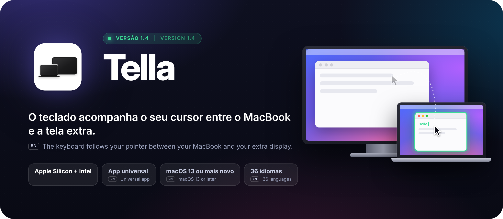
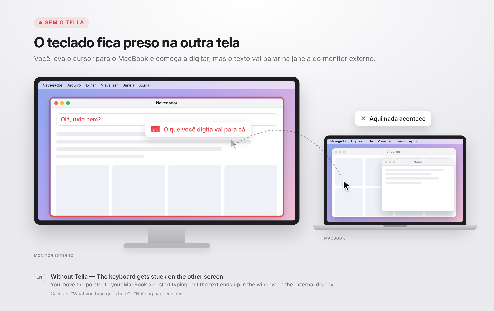
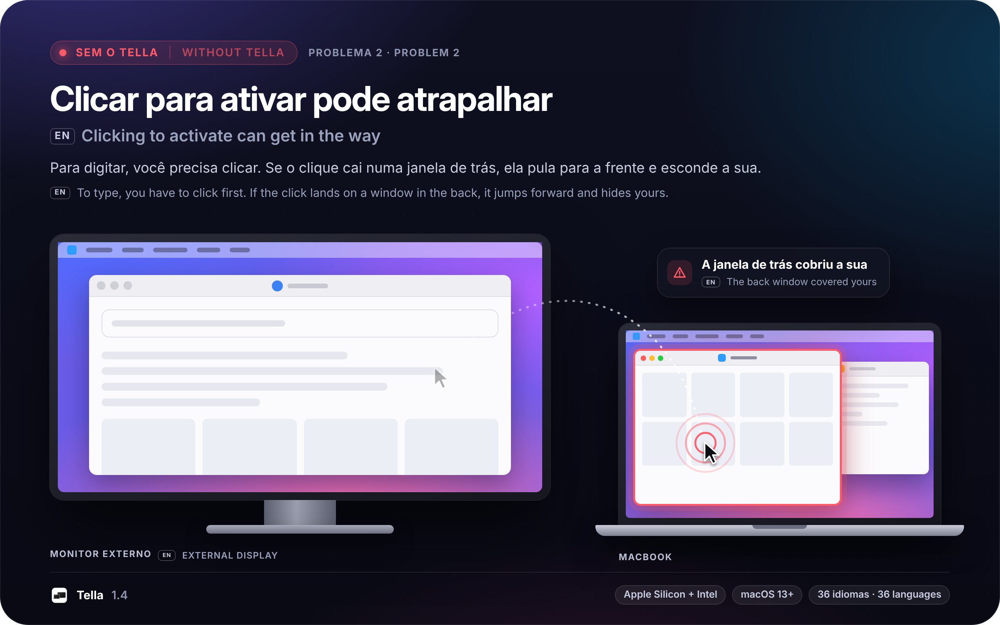
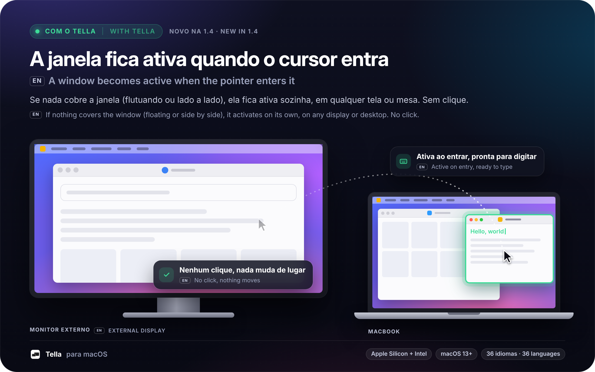
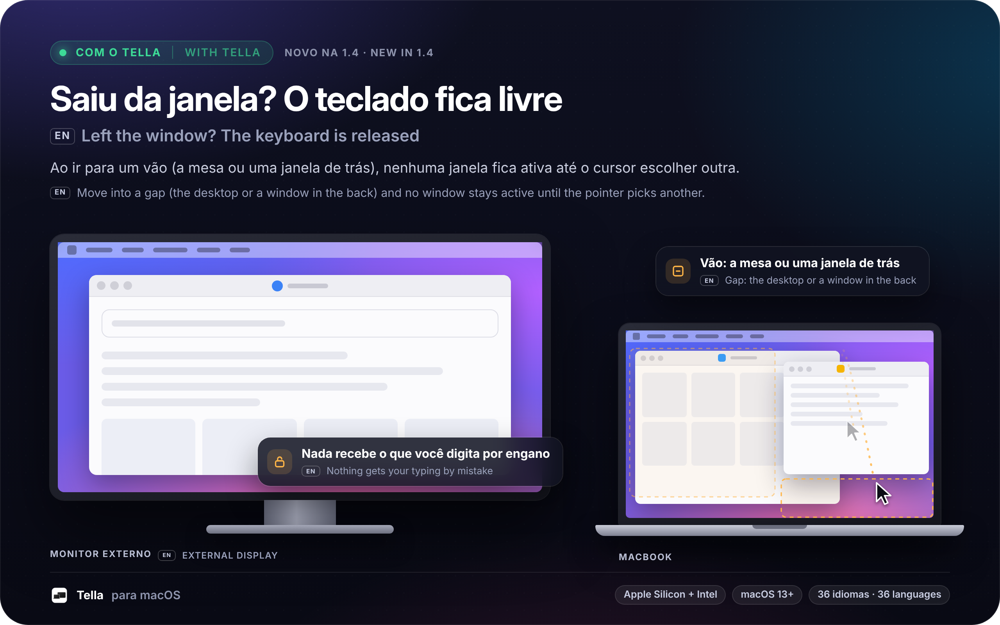
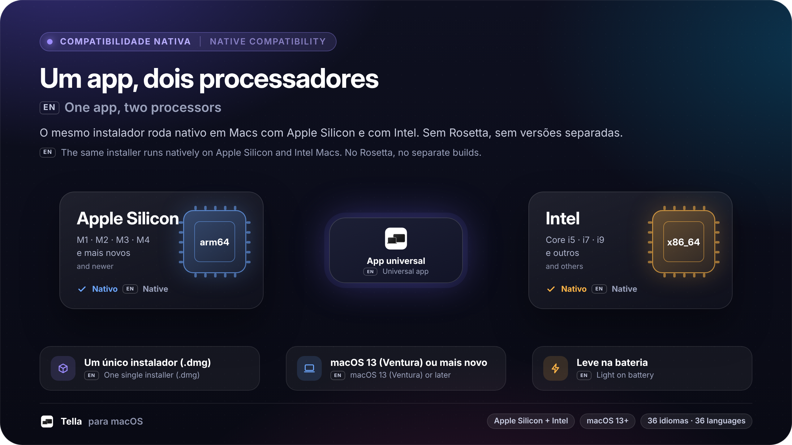
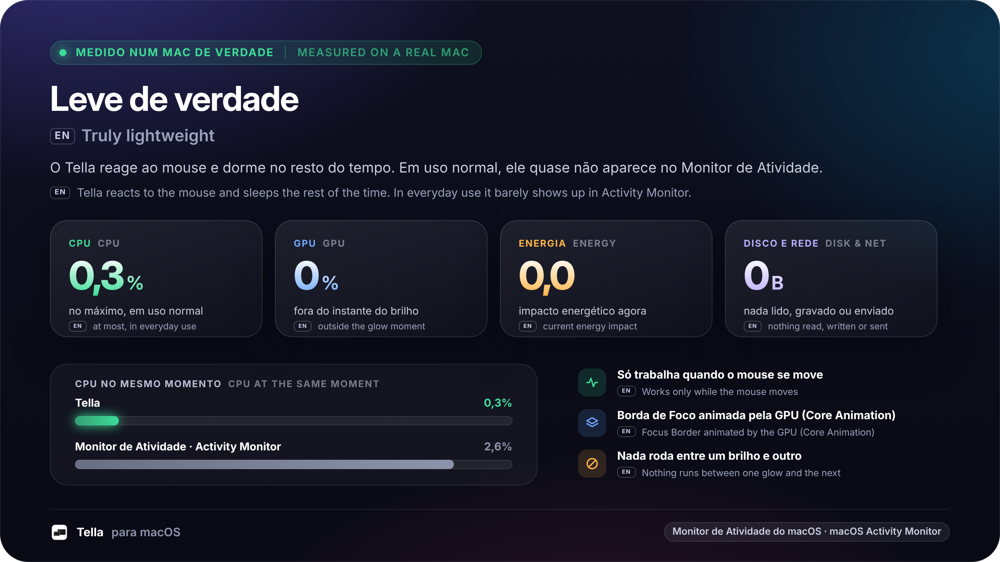

<p align="center">
  
</p>

<h1 align="center">Tella</h1>

<p align="center">
  <b>Your keyboard follows your cursor between your MacBook and your external displays — no clicking.</b>
</p>

<p align="center">
  <b>English</b> · <a href="README.pt-BR.md">Português</a> · <a href="README.es.md">Español</a>
</p>

<p align="center">
  <a href="https://github.com/arthuislan/tella/releases/download/v1.4/Tella-1.4.dmg"><b>⬇︎ Download Tella 1.4</b></a>
  &nbsp;·&nbsp; macOS 13+ · Apple Silicon & Intel
</p>

<p align="center">
  
</p>

**Tella** is a small Mac app for people who work with a **MacBook and one or more external displays**. When you move the cursor to another display, Tella automatically activates the front window on that display, so you can start typing right away **without clicking**.

It lives quietly in the menu bar: no windows, nothing gets moved, and nothing gets clicked.

---

## The problem

On macOS, keystrokes always go to the **active app**, and an app only becomes active when you click it. Moving the cursor is not enough. With more than one display, that causes two everyday annoyances.

### 1. The keyboard stays stuck on the other display

You are in your browser on the external display, move the cursor to the MacBook and start typing a note. The text ends up in the browser's address bar, on the other display.



### 2. Clicking to activate can get in the way

The workaround is to click the other display before typing. But the cursor often lands on a larger **window behind** the small window you are using. The click hits it, it jumps to the front and **covers the window you wanted**.



---

## The solution

With Tella on, the keyboard follows the cursor. A window that **nothing covers** — floating on top or side by side — becomes active as soon as the cursor enters it, on any display and any desktop.

- ✅ The keyboard follows the cursor: just point and type.
- ✅ No click is simulated, so no button or link is ever pressed by accident.
- ✅ No window moves, and the window in the back stays in the back.



When the cursor leaves for an empty spot (the desktop or a window in the back), the keyboard is **released**: no window stays active, so nothing you type lands in the wrong place.



---

## How it works

### Coming from another display

1. When the cursor **changes display**, Tella waits until it reaches a window, so it never picks a window before you get there.
2. If the cursor enters a window that **nothing covers**, that window becomes active.
3. Anywhere else (menu bar, desktop, or a window partly behind another), nothing changes: a window only becomes active when the cursor chooses it.

### Windows under the cursor

With **Activate Window Under Cursor** on (the default), every window that **nothing covers** — floating on top of the others or side by side, like Finder on the left and Terminal on the right — becomes active as soon as the cursor enters it. No click needed, on the MacBook, on the external display and on every desktop (Space).

When the cursor **leaves** that window for an empty spot — the desktop, or a window in the back like the space between Finder and Terminal — the window is **released**: no window stays active until the cursor chooses another one, so nothing you type goes to the wrong place. The menu bar, menus and the Dock don't count, so you can still reach the active app's menus.

A window that is **partly behind another one** is never activated by the cursor: activating it would bring it forward and cover the window in front. For those, you click, as always. No window ever moves or changes order.

Turn **Activate Window Under Cursor** off to get the classic behavior: Tella only acts when the cursor changes display, always activating the frontmost window there.

### When you minimize a window

If you minimize the window you were using, Tella **immediately** activates the window that is now in front on that display — usually the one that was behind it — so you can keep typing without clicking.

### Built-in safeguards

- **Dragging something?** While a mouse button is held down, Tella does nothing, so it never interrupts a drag.
- **Spotlight, Raycast, Alfred and similar panels:** while one is open, Tella doesn't switch windows, so it never closes them.
- **Menus, the Dock and alerts under the cursor:** Tella ignores them.
- **Plugged or unplugged a display?** Tella just updates its reference and activates nothing.
- **Battery friendly:** Tella only works while the mouse is moving.

Everything goes through the macOS Accessibility API.

---

## Menu bar menu

| Option | What it does |
|---|---|
| **About Tella** | Shows the version, the developer, the website and the license. |
| **Update Available: Tella x.y** | Appears only when there is a new version. Click to download it. |
| **Enabled** | Turns Tella on or off without quitting the app. |
| **Activate Window Under Cursor** | Windows that nothing covers become active when the cursor enters them (on by default). Off = classic behavior. |
| **Open at Login** | Starts Tella automatically when you log in. |
| **Permission** | Shows whether Accessibility is allowed (✓) or missing (⚠︎) and groups the options below. |
| ↳ **Open Accessibility Settings…** | Opens the Accessibility list in System Settings. |
| ↳ **Request Permission Again** | Shows the macOS prompt again and adds Tella to the list. |
| ↳ **Reset Permission** | Clears the old permission and asks again. Useful after updating the app. |
| ↳ **Show Tella in Finder** | Reveals the app in Finder so you can drag it into the list if it doesn't appear. |
| **Check for Updates…** | Checks GitHub right now for a new version. |
| **Check for Updates Automatically** | Checks once a day (on by default). Turn it off if you prefer. |
| **Quit Tella** | Quits the app. |

---

## Languages

Tella automatically uses your Mac's language. It speaks **36 languages**:

Português (Brasil) · Português (Portugal) · English · Español · Français · Deutsch · Italiano · Nederlands · Svenska · Dansk · Norsk · Suomi · Polski · Čeština · Slovenčina · Magyar · Română · Hrvatski · Slovenščina · Български · Català · Ελληνικά · Türkçe · Русский · Українська · עברית · العربية · हिन्दी · ไทย · Tiếng Việt · Bahasa Indonesia · Bahasa Melayu · 日本語 · 한국어 · 简体中文 · 繁體中文

If your Mac's language is not on the list, Tella appears in **English**.

To use Tella in a different language without changing your whole Mac, go to **System Settings → General → Language & Region → Applications**, click **+** and choose Tella.

---

## Requirements

- macOS 13 (Ventura) or later
- Mac with Apple Silicon (M1, M2, M3, M4…) or Intel
- **Accessibility** permission, which Tella needs to activate other apps' windows



---

## Performance

Tella stays on all day, so it was built to be invisible to your battery. Measured with macOS Activity Monitor on a MacBook Pro in everyday use (Tella 1.6 beta):

| Resource | Tella |
|---|---|
| **CPU** | 0.2% – 0.3% |
| **GPU** | 0.0% outside the Focus Border animation |
| **Energy impact** | 0.0 now · 1.44 over the last 12 hours |
| **Disk and network** | 0 bytes |

At the same moment, Activity Monitor itself was using **2.6%** of the CPU, about **9 times more** than Tella.

- **Event-driven:** Tella listens to mouse movement and sleeps while the mouse is still. It never polls the system in a loop.
- **GPU-animated Focus Border** *(coming in Tella 1.6)*: the glow is a small pre-rendered image that macOS stretches to the window and animates with Core Animation. Nothing keeps running between one glow and the next.
- **No disk or network in daily use:** settings are written only when you change them, and the update check runs once a day (you can turn it off).



Full report, with how it was measured and how to check it yourself: **[docs/DESEMPENHO.md](docs/DESEMPENHO.md)** (in Portuguese).

---

## Installation

### With the installer (DMG)

1. Download **[Tella-1.4.dmg](https://github.com/arthuislan/tella/releases/download/v1.4/Tella-1.4.dmg)** from the [Releases](https://github.com/arthuislan/tella/releases) page.
2. Open the DMG and drag **Tella** into the **Applications** folder.
3. Open Tella. Because the app is not notarized by Apple, macOS may say it can't verify the developer the first time. To open it anyway, go to **System Settings → Privacy & Security** and click **Open Anyway**, or right-click the app and choose **Open**.
4. When Tella asks, turn on its permission in **System Settings → Privacy & Security → Accessibility**.

---

## Troubleshooting

**Tella doesn't activate windows.**
Most of the time it's the Accessibility permission. After an update, macOS may treat Tella as a different app.

The easiest fix is from Tella itself: in the menu, choose **Permission → Reset Permission** and turn Tella on again in the Accessibility list.

Or, from Terminal:

```bash
pkill -x Tella
tccutil reset Accessibility local.tella
open /Applications/Tella.app
```

Then turn Tella on again under **Accessibility**.

**The old icon still shows up.**
That's the macOS cache. To refresh it:

```bash
touch /Applications/Tella.app && killall Dock Finder
```

**How do I uninstall?**

```bash
pkill -x Tella
rm -rf /Applications/Tella.app
tccutil reset Accessibility local.tella
```

---

## Updates

Tella checks the [Releases](https://github.com/arthuislan/tella/releases) page once a day. When a new version is out, it lets you know and shows **Update Available** in the menu.

To update: download the new **Tella-x.y.dmg**, open it and drag Tella into **Applications**, replacing the old one. After updating, macOS may ask you to allow Tella under **Accessibility** again — if it doesn't work right away, use **Permission → Reset Permission** in the menu.

---

## Privacy

Tella **does not read what you type** and records nothing. It only looks at the cursor position and the list of open windows to know which window to activate.

The only time it goes online is to check the public Tella releases page on GitHub for a new version, at most once a day. Nothing about you or your Mac is sent. You can turn this off with **Check for Updates Automatically**.

---

See [CHANGELOG.md](CHANGELOG.md) for the version history.

---

## License

**Free to use, all rights reserved** © 2026 Arthuislan. Tella is free of charge for personal and professional use, but it is not open source: copying, modifying, redistributing or reverse engineering it is not allowed without permission. Full terms in [LICENSE](LICENSE).

Versions up to 1.5 were released under the MIT License.
