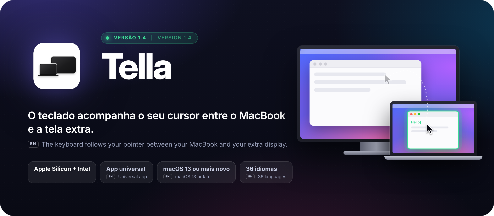
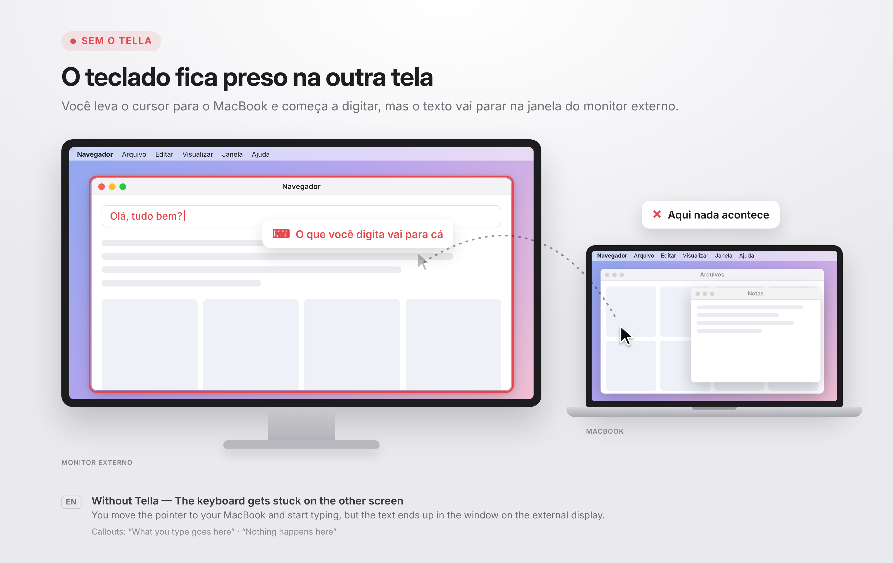
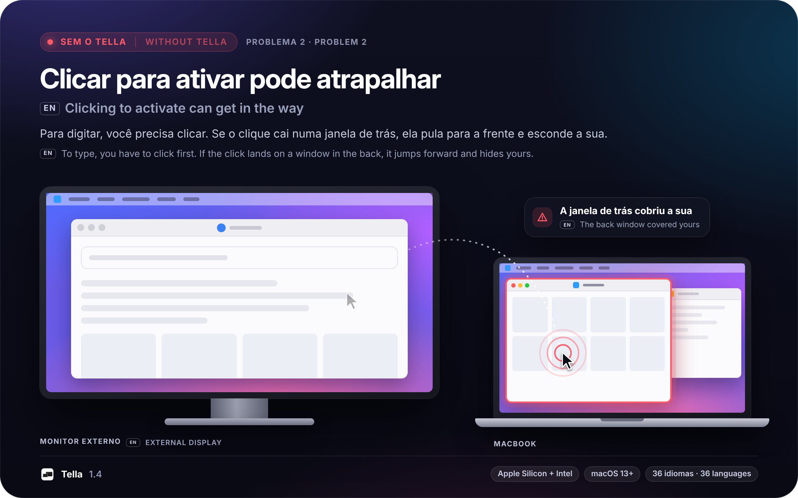
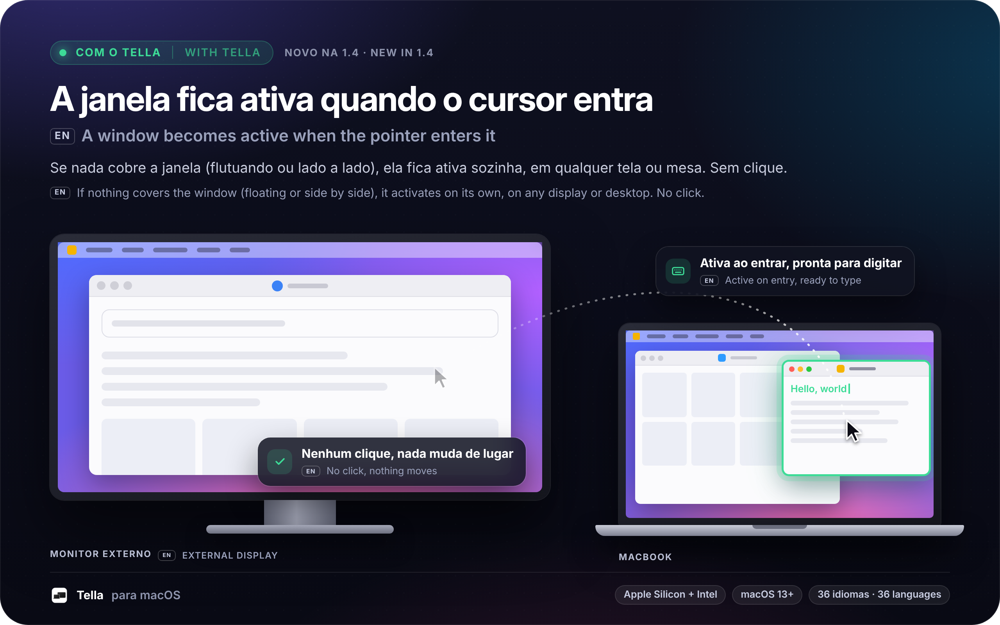
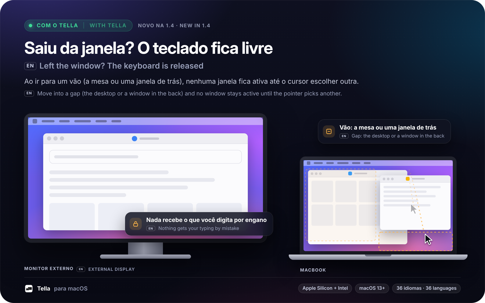
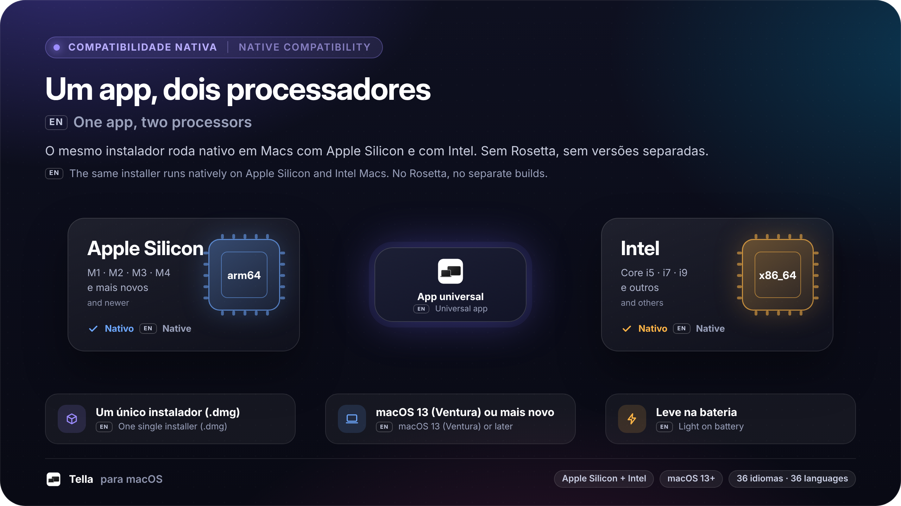
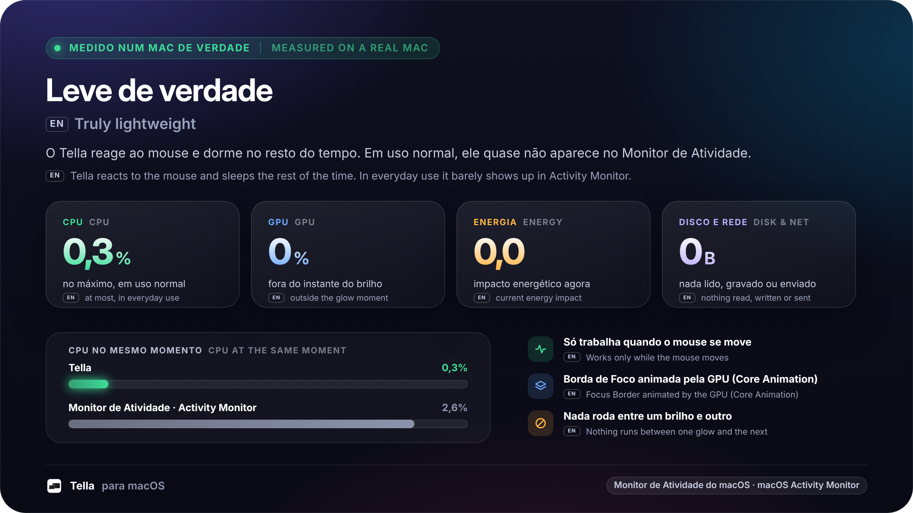

<p align="center">
  
</p>

<h1 align="center">Tella</h1>

<p align="center">
  <b>O teclado acompanha o seu cursor entre o MacBook e os monitores externos, sem clicar.</b>
</p>

<p align="center">
  <a href="README.md">English</a> · <b>Português</b> · <a href="README.es.md">Español</a>
</p>

<p align="center">
  <a href="https://github.com/arthuislan/tella/releases/download/v1.4/Tella-1.4.dmg"><b>⬇︎ Baixar Tella 1.4</b></a>
  &nbsp;·&nbsp; macOS 13+ · Apple Silicon e Intel
</p>

<p align="center">
  
</p>

**Tella** é um pequeno app para Mac, feito para quem trabalha com **MacBook e um ou mais monitores externos**. Quando você leva o cursor para outra tela, o Tella ativa automaticamente a janela que está na frente nessa tela. Assim, você já pode digitar nela **sem precisar clicar**.

Ele fica discreto na barra de menus, não abre janelas, não muda nada de lugar e não clica em nada.

---

## O problema

No macOS, o teclado sempre vai para o **app ativo**, e o app só fica ativo quando você clica nele. Mover o cursor não basta. Com mais de uma tela, isso gera duas situações chatas do dia a dia.

### 1. O teclado fica preso na outra tela

Você está no navegador do monitor externo, leva o cursor para o MacBook e começa a digitar uma nota. O texto vai parar na barra de endereço do navegador, na outra tela.



### 2. Clicar para ativar pode atrapalhar

A solução seria clicar na outra tela antes de digitar. O problema é que o cursor costuma chegar à tela do lado, e ali muitas vezes há uma **janela de trás**, maior, atrás da janela pequena que você está usando. O clique cai nela, ela pula para a frente e **cobre a janela que você queria usar**.



---

## A solução

Com o Tella ligado, o teclado acompanha o cursor. Uma janela que **nada cobre** — flutuando por cima ou lado a lado — fica ativa assim que o cursor entra nela, em qualquer tela e em qualquer mesa.

- ✅ O teclado acompanha o cursor: é só apontar e digitar.
- ✅ Nenhum clique é simulado, então nenhum botão ou link é acionado sem querer.
- ✅ Nenhuma janela muda de lugar, e a de trás continua atrás.



Quando o cursor sai para um vão (a mesa ou uma janela de trás), o teclado é **solto**: nenhuma janela fica ativa, então nada do que você digita vai para o lugar errado.



---

## Como funciona

### Ao chegar de outra tela

1. Quando o cursor **muda de tela**, o Tella espera ele chegar a uma janela, para nunca escolher uma janela antes de você chegar nela.
2. Se o cursor entra numa janela que **nada cobre**, essa janela fica ativa.
3. Em qualquer outro lugar (barra de menus, mesa ou janela parcialmente atrás de outra), nada muda: uma janela só fica ativa quando o cursor a escolhe.

### Janelas sob o cursor

Com **Ativar janela sob o cursor** ligado (padrão), toda janela que **nada cobre** — flutuando por cima das outras ou lado a lado, como o Finder à esquerda e o Terminal à direita — fica ativa assim que o cursor entra nela. Sem clique, no MacBook, no monitor externo e em todas as mesas (Spaces).

Quando o cursor **sai** dessa janela para um espaço vazio — a mesa, ou uma janela de trás, como o espaço entre o Finder e o Terminal — a janela é **solta**: nenhuma janela fica ativa até o cursor escolher outra, então nada do que você digitar vai para o lugar errado. A barra de menus, os menus e o Dock não contam, então você continua alcançando os menus do app ativo.

Uma janela **parcialmente atrás de outra** nunca é ativada pelo cursor: ativá-la a traria para a frente e cobriria a janela da frente. Nesses casos, você clica, como sempre. Nenhuma janela muda de lugar nem de ordem.

Desligue **Ativar janela sob o cursor** para ter o comportamento clássico: o Tella só age quando o cursor muda de tela, sempre ativando a janela da frente daquela tela.

### Ao minimizar uma janela

Se você minimiza a janela que estava usando, o Tella ativa **na hora** a janela que ficou na frente naquela tela, normalmente a que estava atrás. Assim, você continua digitando sem precisar clicar nela.

### Cuidados que o app toma

- **Arrastando algo?** Com o botão do mouse pressionado, o Tella não faz nada, para não atrapalhar o arraste.
- **Spotlight, Raycast, Alfred e painéis parecidos:** enquanto um deles está aberto, o Tella não troca de janela, para não fechá-lo.
- **Menus, Dock e avisos embaixo do cursor:** o Tella ignora.
- **Ligou ou desligou um monitor?** O Tella só atualiza a referência e não ativa nada.
- **Economiza bateria:** o Tella só trabalha enquanto o mouse se move.

Tudo pela API de Acessibilidade do macOS.

---

## Menu da barra de menus

| Opção | O que faz |
|---|---|
| **Sobre o Tella** | Mostra a versão, o desenvolvedor, o site e a licença. |
| **Atualização disponível: Tella x.y** | Só aparece quando há versão nova. Clique para baixar. |
| **Ativo** | Liga ou desliga o Tella sem precisar fechar o app. |
| **Ativar janela sob o cursor** | Janelas que nada cobre ficam ativas quando o cursor entra nelas (ligado por padrão). Desligado = comportamento clássico. |
| **Abrir ao iniciar sessão** | Abre o Tella sozinho quando você liga o Mac. |
| **Permissão** | Mostra se a Acessibilidade está permitida (✓) ou faltando (⚠︎) e reúne as opções abaixo. |
| ↳ **Abrir Ajustes de Acessibilidade…** | Abre direto a lista de Acessibilidade nos Ajustes do Sistema. |
| ↳ **Pedir permissão novamente** | Mostra de novo o aviso do macOS e coloca o Tella na lista. |
| ↳ **Redefinir permissão** | Apaga a permissão antiga e pede de novo. É útil depois de atualizar o app. |
| ↳ **Mostrar o Tella no Finder** | Mostra o app no Finder, para você arrastá-lo para a lista se ele não aparecer lá. |
| **Procurar atualizações…** | Confere agora no GitHub se há versão nova. |
| **Procurar atualizações automaticamente** | Confere uma vez por dia (ligado por padrão). Desligue se preferir. |
| **Sair do Tella** | Fecha o app. |

---

## Idiomas

O Tella usa automaticamente o idioma do seu Mac. São **36 idiomas**:

Português (Brasil) · Português (Portugal) · English · Español · Français · Deutsch · Italiano · Nederlands · Svenska · Dansk · Norsk · Suomi · Polski · Čeština · Slovenčina · Magyar · Română · Hrvatski · Slovenščina · Български · Català · Ελληνικά · Türkçe · Русский · Українська · עברית · العربية · हिन्दी · ไทย · Tiếng Việt · Bahasa Indonesia · Bahasa Melayu · 日本語 · 한국어 · 简体中文 · 繁體中文

Se o idioma do Mac não estiver na lista, o Tella aparece em **inglês**.

Para usar o Tella em outro idioma sem mudar o Mac inteiro, vá em **Ajustes do Sistema → Geral → Idioma e Região → Aplicativos**, clique em **+** e escolha o Tella.

---

## Requisitos

- macOS 13 (Ventura) ou mais novo
- Mac com Apple Silicon (M1, M2, M3, M4…) ou Intel
- Permissão de **Acessibilidade**, que o Tella precisa para ativar janelas de outros apps



---

## Desempenho

O Tella fica ligado o dia inteiro, por isso foi feito para ser invisível para a bateria. Medido no Monitor de Atividade do macOS, num MacBook Pro em uso normal (Tella 1.6 beta):

| Recurso | Tella |
|---|---|
| **CPU** | 0,2% – 0,3% |
| **GPU** | 0,0% fora da animação da Borda de Foco |
| **Impacto energético** | 0,0 agora · 1,44 na média de 12 horas |
| **Disco e rede** | 0 bytes |

No mesmo instante, o próprio Monitor de Atividade usava **2,6%** de CPU, cerca de **9 vezes mais** que o Tella.

- **Orientado a eventos:** o Tella escuta o movimento do mouse e dorme enquanto o mouse está parado. Ele nunca fica consultando o sistema em repetição.
- **Borda de Foco animada pela GPU** *(chega no Tella 1.6)*: a luz é uma imagem pequena e pronta, que o macOS estica até o tamanho da janela e anima com o Core Animation. Nada fica rodando entre um brilho e outro.
- **Sem disco nem rede no dia a dia:** os ajustes só são gravados quando você muda alguma coisa, e a conferência de atualização acontece uma vez por dia (dá para desligar).



Relatório completo, com a forma de medir e como conferir você mesmo: **[docs/DESEMPENHO.md](docs/DESEMPENHO.md)**.

---

## Instalação

### Pelo instalador (DMG)

1. Baixe o **[Tella-1.4.dmg](https://github.com/arthuislan/tella/releases/download/v1.4/Tella-1.4.dmg)** na página de [Releases](https://github.com/arthuislan/tella/releases).
2. Abra o DMG e arraste o **Tella** para a pasta **Aplicativos**.
3. Abra o Tella. Como o app não é autenticado pela Apple, na primeira vez o macOS pode avisar que não consegue verificar o desenvolvedor. Para abrir mesmo assim, use **Ajustes do Sistema → Privacidade e Segurança → Abrir Mesmo Assim**, ou clique no app com o botão direito e escolha **Abrir**.
4. Quando o Tella pedir, ligue a permissão em **Ajustes do Sistema → Privacidade e Segurança → Acessibilidade**.

---

## Solução de problemas

**O Tella não ativa as janelas.**
Na maioria das vezes, é a permissão de Acessibilidade. Depois de uma atualização, o macOS pode passar a tratar o Tella como outro app.

O jeito mais fácil de corrigir é pelo próprio Tella: no menu, vá em **Permissão → Redefinir permissão** e ligue o Tella de novo na lista de Acessibilidade.

Se preferir, pelo Terminal:

```bash
pkill -x Tella
tccutil reset Accessibility local.tella
open /Applications/Tella.app
```

Depois ligue o Tella de novo em **Acessibilidade**.

**O ícone antigo continua aparecendo.**
É cache do macOS. Para atualizar:

```bash
touch /Applications/Tella.app && killall Dock Finder
```

**Como desinstalar?**

```bash
pkill -x Tella
rm -rf /Applications/Tella.app
tccutil reset Accessibility local.tella
```

---

## Atualizações

O Tella confere uma vez por dia a página de [Releases](https://github.com/arthuislan/tella/releases). Quando sai uma versão nova, ele avisa e mostra **Atualização disponível** no menu.

Para atualizar: baixe o novo **Tella-x.y.dmg**, abra e arraste o Tella para **Aplicativos**, substituindo o antigo. Depois de atualizar, o macOS pode pedir de novo a permissão de **Acessibilidade**. Se não funcionar na hora, use **Permissão → Redefinir permissão** no menu.

---

## Privacidade

O Tella **não lê o que você digita** e não grava nada. Ele só observa a posição do cursor e a lista de janelas abertas, para saber qual janela ativar.

A única vez que ele acessa a internet é para conferir, no máximo uma vez por dia, a página pública de versões do Tella no GitHub. Nada sobre você ou o seu Mac é enviado. Dá para desligar em **Procurar atualizações automaticamente**.

---

Veja o [CHANGELOG.md](CHANGELOG.md) para o histórico de versões.

---

## Licença

**Gratuito, todos os direitos reservados** © 2026 Arthuislan. O Tella é grátis para uso pessoal e profissional, mas não é de código aberto: copiar, modificar, redistribuir ou fazer engenharia reversa não é permitido sem autorização. Termos completos em [LICENSE](LICENSE).

As versões até a 1.5 foram publicadas sob a Licença MIT.
