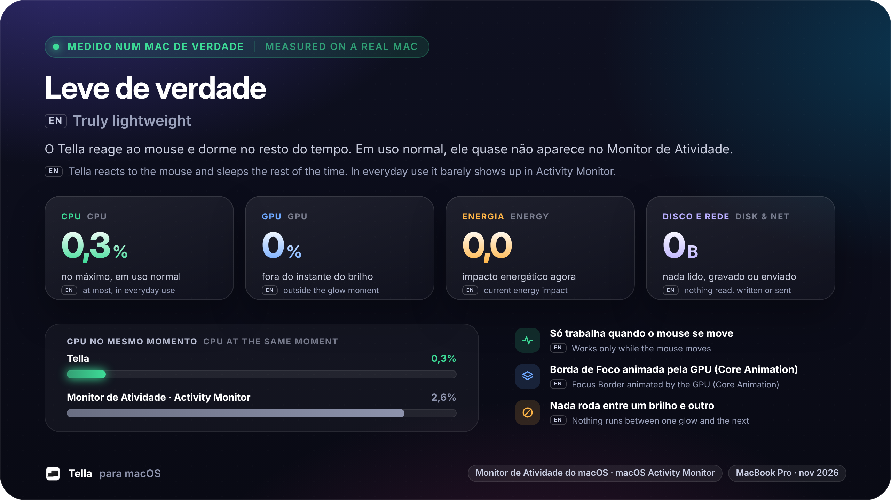

  

<h1 align="center">Desempenho do Tella</h1>

  <i>Um utilitário que fica ligado o dia inteiro precisa ser invisível para a bateria. 
  Este documento mostra quanto o Tella consome e por que consome tão pouco.</i>

---

## Resumo

| Recurso | Em uso normal | O que isso significa |
|---|---|---|
| **CPU** | **0,2% – 0,3%** | Um núcleo quase sempre ocioso. Mesmo durante um brilho, o pico é curto, de 1 a 3 segundos. |
| **GPU** | **0,0%** | A placa de vídeo só trabalha no instante da Borda de Foco. Fora dele, não há nada para desenhar. |
| **Impacto energético** | **0,0** agora · **1,44** na média de 12 h | Fica entre os apps que menos gastam bateria no Mac. |
| **Disco** | **0 bytes** lidos e gravados | Nada é gravado durante o uso: só os ajustes, quando você muda alguma coisa. |
| **Rede** | **0 bytes** | Nenhum dado sai do Mac. A única exceção é a conferência de atualização, uma vez por dia, que você pode desligar. |
| **Threads** | **4** | A linha principal e as linhas que o próprio macOS cria para apps de interface. |

Para comparar: no mesmo instante, o próprio **Monitor de Atividade** usava **2,6%** de CPU, cerca de **9 vezes mais** que o Tella.

---

## Como foi medido

| | |
|---|---|
| **Ferramenta** | Monitor de Atividade do macOS (abas CPU, Memória, Energia, Disco e Rede) |
| **Máquina** | MacBook Pro com 48 GB de memória, ligado a um monitor externo Dell S2725QC |
| **Versão medida** | Tella 1.6 (versão de teste t38), compilação universal (Apple Silicon + Intel) |
| **Data** | 16 de novembro de 2026 |
| **Situação** | Uso normal: vários apps abertos, troca de janelas e de telas, Borda de Foco ligada |

> Os valores são do Tella em uso normal. Durante uma animação da Borda de Foco, a CPU e a GPU sobem por 1 a 3 segundos e voltam a quase zero logo depois. A medição de memória não entrou na tabela: o Monitor de Atividade ainda não tinha carregado o valor do processo, que tinha acabado de ser reaberto.

---

## Por que o Tella é tão leve

### 1. Orientado a eventos, não a verificações
O Tella não fica perguntando ao sistema, a todo instante, onde o cursor está. Ele **escuta os movimentos do mouse** e só faz alguma coisa quando o cursor muda de tela ou entra numa janela. Com o mouse parado, o processo dorme e não consome nada.

### 2. Perguntas baratas ao macOS
Quando precisa saber onde está uma janela, o Tella consulta **uma janela só**, e não a lista inteira. A posição da janela ativa fica guardada e só é conferida de novo a cada 0,3 s, no máximo. Na troca de janela, as conferências seguidas reaproveitam a mesma resposta.

### 3. Borda de Foco desenhada uma vez e animada pela GPU *(chega no Tella 1.6)*
- A luz é uma **imagem pequena, pronta e guardada**. O macOS a estica até o tamanho da janela (`contentsCenter`), então acender, mudar de tamanho ou trocar de janela não redesenha nada.
- Quem anima é o **Core Animation**, no servidor de janelas do macOS, usando a GPU. O app só descreve o movimento uma vez.
- Enquanto a borda está acesa, a janela é conferida 20 vezes por segundo. Quando a borda some, **nada continua rodando**.
- Os efeitos mais ricos, como Glitch, Portal, Holograma e Campo de força, usam cópias em meia resolução e quadros pré-gerados (o chuvisco do Glitch é criado direto na memória, uma única vez).

### 4. Nada de disco nem de rede no dia a dia
- Os ajustes ficam nas preferências do macOS e só são gravados quando você muda alguma coisa.
- O registro de diagnóstico só existe se você ligar o modo diagnóstico.
- A conferência de atualização acontece **uma vez por dia**, é um pedido pequeno ao GitHub e pode ser desligada no menu.

### 5. Detecção de janelas claras e escuras sob demanda *(chega no Tella 1.6)*
Quando está ligada (é opcional e precisa da permissão de Gravação de Tela), a detecção tira uma **miniatura de 64 × 40 pixels** da janela, só no instante da borda, e guarda apenas a resposta "clara" ou "escura". Nas vezes seguintes, a resposta guardada é usada na hora e conferida de novo em segundo plano.

### 6. Pausa em jogos e em tela cheia
Em jogos e em apps de tela cheia, a Borda de Foco não aparece. O **Modo jogo** pode pausar o Tella por inteiro, e aí ele não processa nada.

---

## Meça você mesmo

1. Abra o **Monitor de Atividade** (Aplicativos → Utilitários).
2. Na busca, digite **Tella**.
3. Confira as abas **CPU**, **Energia**, **Disco** e **Rede**. Na aba Energia, a coluna de média de 12 horas mostra o consumo ao longo do dia.

> No Monitor de Atividade também pode aparecer **"Preencher Automaticamente (Tella)"**. Ele é um processo do próprio macOS, aberto para o preenchimento automático, e não faz parte do Tella.

---

Tella · leve por princípio: trabalha quando você move o mouse e descansa quando você para.

